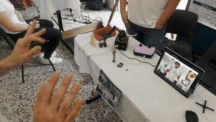
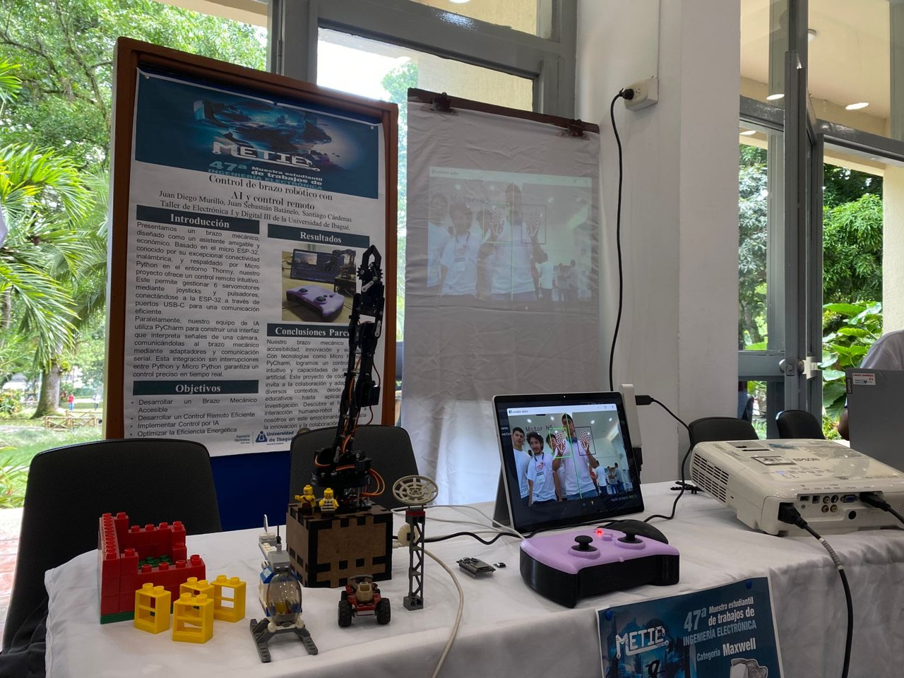
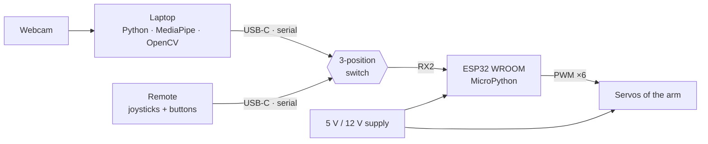
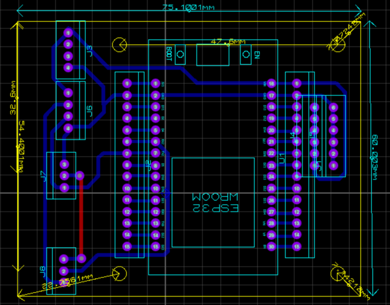
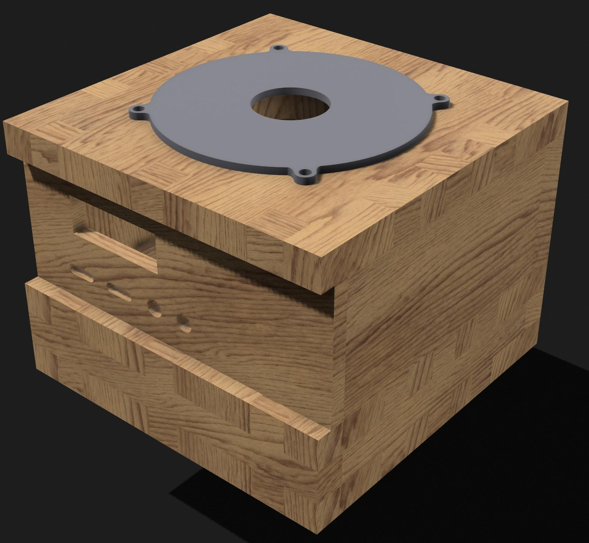
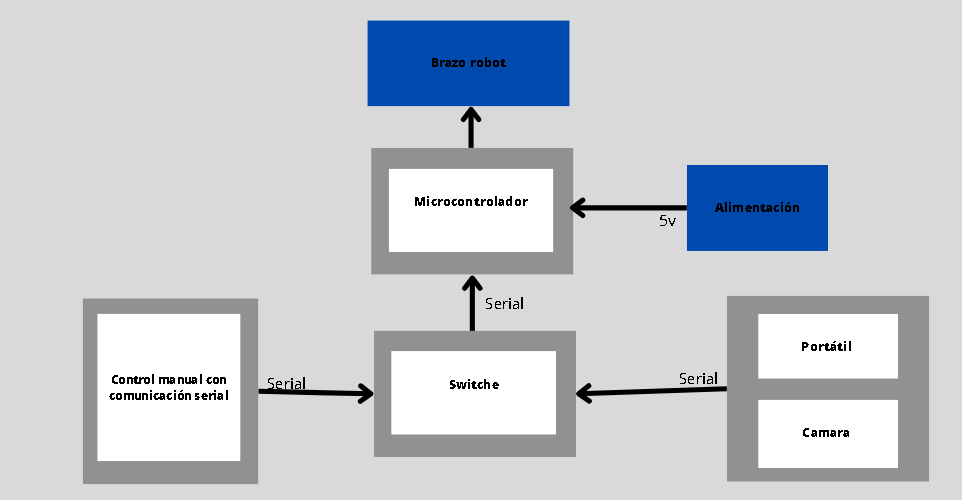
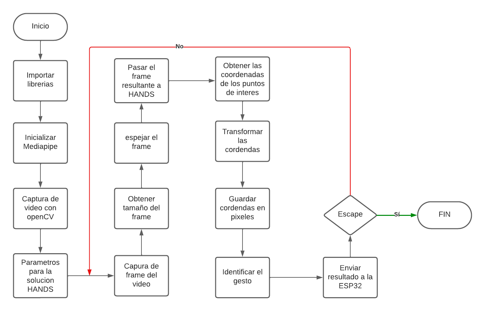

# Gesture-controlled robotic arm

A 6-servo robotic arm driven by an **ESP32** that can be controlled in two ways: with **hand gestures read by a webcam** (MediaPipe Hands + OpenCV on a laptop), or with a **handheld remote** (joysticks and push buttons). A 3-position switch on the custom PCB selects which source talks to the arm.

Course project for *Taller de Electrónica I* and *Digital III*, Universidad de Ibagué (2023). Shown at **METIE, the 47th student exhibition of Electronic Engineering projects**.

<p align="center">
  <br>
  
</p>

## How it works



**Vision side** (`vision/gesture_detection.py`)

- MediaPipe Hands tracks up to two hands (21 landmarks each) at webcam frame rate.
- **Left hand → which motor.** The number of raised fingers (0–5) selects the servo to move. A finger counts as raised when its tip is above its middle joint; the thumb is checked sideways.
- **Right hand → which direction.** The position of the middle fingertip relative to the wrist gives *still*, *turn right* or *turn left*.
- The FPS counter and the landmarks are drawn on the live image.

**Arm side** (ESP32 firmware, MicroPython in Thonny)

- At start-up every servo goes to 90° and the gripper to 0°.
- The main loop reads codes from serial port RX2. Each valid code adjusts the angle of one servo, and the new angle is written as a PWM signal.
- The same protocol is used by the laptop and by the remote, so the switch is the only thing that changes between modes.

## Hardware

| | |
|---|---|
| Controller | ESP32 WROOM on a custom PCB (75 mm) |
| Actuators | 6 servomotors (arm joints + gripper) |
| Remote | 2 joysticks + push buttons, 3D-printed case |
| Links | USB-C female ports, USB (D+/D−) to TTL adapter |
| Mode select | 3-position switch: PC / off / remote |
| Power | 5 V / 12 V |
| Enclosure | Modeled in Shapr3D |

<p align="center">
  
  
</p>

<details>
<summary>Block diagram and program flowchart (Spanish, from the original report)</summary>

<p align="center">
  
  
</p>
</details>

## Run the gesture detection

```bash
cd vision
pip install -r requirements.txt
python gesture_detection.py      # Esc to quit
```

The script prints the detected gesture for each frame (`dedos=` for the left hand, `derecha/izquierda` for the right hand).

## About the code in this repository

The original source files were lost. `vision/gesture_detection.py` was **transcribed from the code listings in the annex of the project report**, keeping the original Spanish names and comments. The serial-sending part (PySerial) and the ESP32 firmware were not included in the report, so they are described above but are not in this repository.

## Team

- Anthony García Ospina
- Juan Diego Murillo Quimbayo
- Walter Andrés Cárdenas Barrios
- Juan Sebastián Batanelo Torres

Universidad de Ibagué, Electronic Engineering, 2023.

## License

[MIT](LICENSE)
